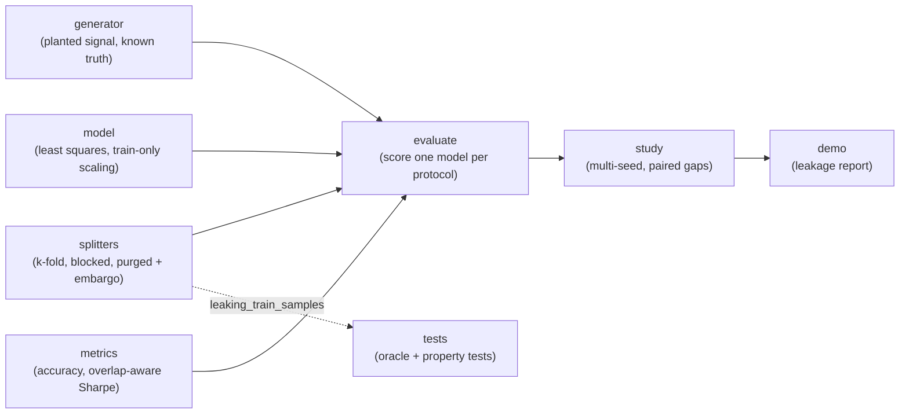

# purgedcv

Purged, embargoed walk-forward cross-validation for time series, plus a harness that measures how much of a backtest's reported skill is leakage.

[](https://github.com/dharmitejani/purgedcv/actions/workflows/ci.yml)

## Why

A time-series model backtests beautifully and loses money live. The causes are structural: k-fold cross-validation on ordered data, label windows that overlap the train/test boundary, and features fitted on the full series before splitting. Each one produces an optimistic number that looks credible until capital is committed.

purgedcv removes the leakage and, more importantly, puts a number on it. It scores one model under four protocols on synthetic data whose true skill is known exactly, so the gap between the reported score and the truth is the leakage.

## Features

- Three splitters as plain functions returning `Fold(train, test)` index lists: shuffled k-fold, contiguous blocked/walk-forward folds, and purged + embargoed folds.
- Purging drops every training sample whose label window `(i, i+h]` touches the test block's label span; the embargo drops the `e` bars after it.
- The label horizon is mandatory. `purged_folds` raises if it is missing, non-integer or below 1, because defaulting it is how overlap leakage is reintroduced.
- `leaking_train_samples` audits any fold against the overlap rule, independently of the splitter that produced it.
- A synthetic generator with a planted signal of exact strength (`alpha`), including the zero-signal case. The Bayes-optimal accuracy is the closed form `0.5 + arcsin(alpha)/pi`.
- A hand-written least-squares linear model (normal equations + Cholesky) that standardises on training rows only.
- A leakage report comparing naive k-fold, walk-forward without purge, purged + embargoed, and true out-of-sample, with multi-seed error bars and paired inflation statistics.
- Pure standard-library Python: no dependencies to install.

## Architecture



The generator emits i.i.d. Gaussian bars, a forward-return label over a fixed horizon, and trailing-mean noise features that are autocorrelated over the same span as the labels. `evaluate` fits the model under each splitter and scores it; the true out-of-sample row fits on the purged training sets and scores on an independently generated future series. `study` repeats this over seeds and reports paired gaps with standard errors. See [docs/ARCHITECTURE.md](docs/ARCHITECTURE.md).

## Quick start

Requires Python 3.11+. Nothing to install.

```bash
git clone https://github.com/dharmitejani/purgedcv.git
cd purgedcv
python3 -m unittest discover -s tests -v   # 28 tests, about 1 s
python3 -m src.demo                        # full leakage report, about 3 s
```

Use the splitters directly:

```python
from src.splitters import purged_folds, kfold_shuffled, leaking_train_samples

folds = purged_folds(1500, 5, horizon=15, embargo=15)
print([(len(f.train), len(f.test), len(leaking_train_samples(f, 15, 15))) for f in folds])
# [(1170, 300, 0), (1155, 300, 0), (1155, 300, 0), (1155, 300, 0), (1185, 300, 0)]

naive = kfold_shuffled(1500, 5, seed=0)
print(sum(len(leaking_train_samples(f, 15)) for f in naive))
# 5980 leaking rows across the five folds (seed 0)

purged_folds(1500, 5, horizon=None, embargo=0)
# ValueError: label horizon must be given explicitly; ...
```

## Example output

`python3 -m src.demo`, experiment 1: 1500 daily bars, 15-bar forward-return labels, 10 pure-noise features, 5 folds, 8 seeds. True skill is exactly zero.

| protocol | accuracy | Sharpe (ann.) | leaking train rows |
|---|---|---|---|
| naive shuffled k-fold | 0.5721 +- 0.0113 | +0.659 +- 0.115 | 5940 |
| walk-forward, no purge | 0.4836 +- 0.0132 | -0.125 +- 0.130 | 120 |
| purged + embargoed | 0.4822 +- 0.0144 | -0.154 +- 0.139 | 0 |
| TRUE out-of-sample | 0.4887 +- 0.0058 | -0.096 +- 0.047 | 0 |

Naive k-fold overstates the truth by +0.755 Sharpe (t=5.1) and +8.35 pp accuracy (t=5.4); purged + embargoed is within noise of the truth (-0.057 Sharpe, t=-0.3).

Experiment 2 plants a real edge (correlation 0.15, Bayes accuracy 0.5479). True Sharpe is +0.14, purged + embargoed reports +0.08 (0.4 standard errors off), and naive k-fold reports +0.84, about 6x the real edge.

Experiment 3 isolates the purge itself: expanding-window walk-forward, 20 folds, 40-bar labels, 20 seeds. Not purging adds +2.29 +- 0.52 pp accuracy (t=4.4) and +0.103 +- 0.030 Sharpe (t=3.4) on zero-signal data.

## Design notes

- **Shuffle is the big leak.** With 5 folds and 15-bar labels, shuffled k-fold leaks 5940 training rows. Unpurged contiguous walk-forward leaks only 120 and is statistically indistinguishable from purged at that setting (t=-0.2). The boundary purge matters when the horizon is large relative to training size, which is what experiment 3 shows.
- **Purge plus embargo.** A training sample is dropped if its label window reaches the test block's span. The embargo additionally drops the `e` bars after that span, where features and labels are still serially correlated with the test block. In `forward_only` mode there is no post-test training data, so the embargo is inert and only the purge acts.
- **Overlap-aware Sharpe.** Positions are held for `horizon` bars, so per-sample P&L is autocorrelated. The Sharpe is computed on a non-overlapping subsample, averaged over all phase offsets, to avoid inflating it by roughly sqrt(horizon).
- **Train-only scaling.** The model standardises with training-row statistics. Fitting the scaler on the whole series is a second classic leak that would contaminate every protocol, including the purged one.
- **Known ground truth.** The planted-signal construction pins the true skill, so inflation is measured against a known value rather than an assumed one.

## Testing

```bash
python3 -m unittest discover -s tests -v
```

28 `unittest` tests cover:

- generator determinism, planted correlation, and the zero-signal property;
- the model recovering a planted signal near the Bayes rate, and scaling on training rows only;
- metrics, including that overlapping trades are not double counted;
- a property test over 2500 configurations (more than 5000 folds) checking purged training sets against an independent set-based overlap oracle, and a minimality check that the purge drops nothing it need not;
- naive splitters leaking at every interior boundary;
- the zero-signal and planted-signal leakage tests, including a deliberately broken purge being detected.

CI runs the suite on every push (`.github/workflows/ci.yml`).

## Project layout

```
src/
  generator.py   synthetic series with planted signal
  splitters.py   k-fold, blocked, purged + embargoed folds, leakage audit
  model.py       least-squares linear score model
  metrics.py     accuracy, overlap-aware annualised Sharpe
  evaluate.py    four-protocol scoring and leakage report
  study.py       multi-seed studies and presets
  demo.py        command-line report
tests/           unittest suites
docs/            architecture notes
```

## Limitations

- Synthetic Gaussian data only: no real market series, fat tails or regime changes. Eight seeds give wide error bars (Sharpe SE about 0.1-0.15).
- The naive Sharpe magnitude depends on horizon, feature count and sample size; +0.66 is specific to the main configuration.
- The purge is conservative: it treats a training window touching the first test bar as overlapping.
- Not implemented: fit-before-split detection on pipeline objects, a deflated Sharpe for multiple configurations, a CLI, and scikit-learn splitter API compatibility.
- It is a validation layer, not a trading strategy or a backtesting engine.

## License

MIT, see [LICENSE](LICENSE).

## Maintainer

Originally authored and currently maintained by Dharmi Tejani, Supply Chain Analyst.

- Email: [dharmitejani1602@gmail.com](mailto:dharmitejani1602@gmail.com)
- LinkedIn: [dharmi-tejani](https://www.linkedin.com/in/dharmi-tejani-888710368)