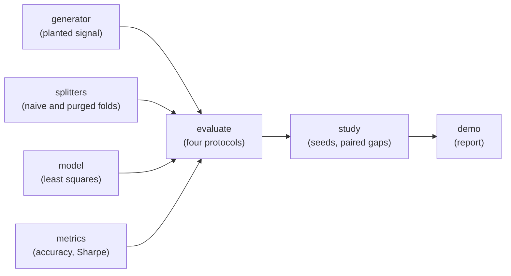

# Architecture

## Context

Backtests on ordered data are routinely evaluated with splitters that leak: shuffled k-fold, or walk-forward folds whose training labels reach into the test period. purgedcv exists to remove that leakage and to measure how much of a reported score it explains. Teams normally rely on a generic `TimeSeriesSplit` and never see the number.

## Container view

Everything is plain functions and frozen dataclasses in pure standard-library Python. A fold is `Fold(train, test)`, two lists of indices.

## Key decisions

**Purge and embargo, with a mandatory horizon.** A training sample `i` has label window `(i, i+h]`. It is dropped if that window touches the test block's span `[lo, hi+h]`. The embargo then drops the `e` bars after the span. `purged_folds` refuses to run without an explicit integer horizon >= 1, because a defaulted horizon silently reintroduces overlap leakage. The cost is a smaller training set.

**Known ground truth.** The generator plants a signal of exact correlation `alpha` with the forward return, so the Bayes-optimal accuracy is `0.5 + arcsin(alpha)/pi`. With `alpha = 0` true skill is zero by construction, so any positive score is leakage. The alternative, real data, has no known truth to compare against.

**Four protocols, one model.** Naive k-fold, walk-forward without purge, purged + embargoed, and true out-of-sample on an independently generated future series. The last is the ruler; the gap to it is the leakage.

**Overlap-aware Sharpe.** P&L from `h`-bar holds is autocorrelated. The Sharpe uses a non-overlapping subsample averaged over all `h` phase offsets, so it is not inflated by roughly sqrt(h).

**Train-only standardisation.** Scaling statistics come from training rows, so the purged protocol is not contaminated by a second leak.

**Independent audit.** `leaking_train_samples` re-derives overlap from the rule rather than from the splitter, so tests can check the splitter against an oracle.

## Failure modes

- Missing, non-integer or non-positive horizon: `ValueError` at split time.
- Negative embargo, fewer than 2 folds, or fewer samples than folds: `ValueError`.
- A broken purge (for example, a horizon one too small) is caught by the audit and by a dedicated test.
- Error bars are wide with few seeds; reported figures carry standard errors and paired t-statistics so they are not read as exact.

## Out of scope

- Real market data, fat tails and regime changes.
- Fit-before-split detection on pipeline objects and a deflated Sharpe.
- A CLI and scikit-learn splitter API compatibility.
- Trading logic: this is the validation layer, not a strategy or backtest engine.
